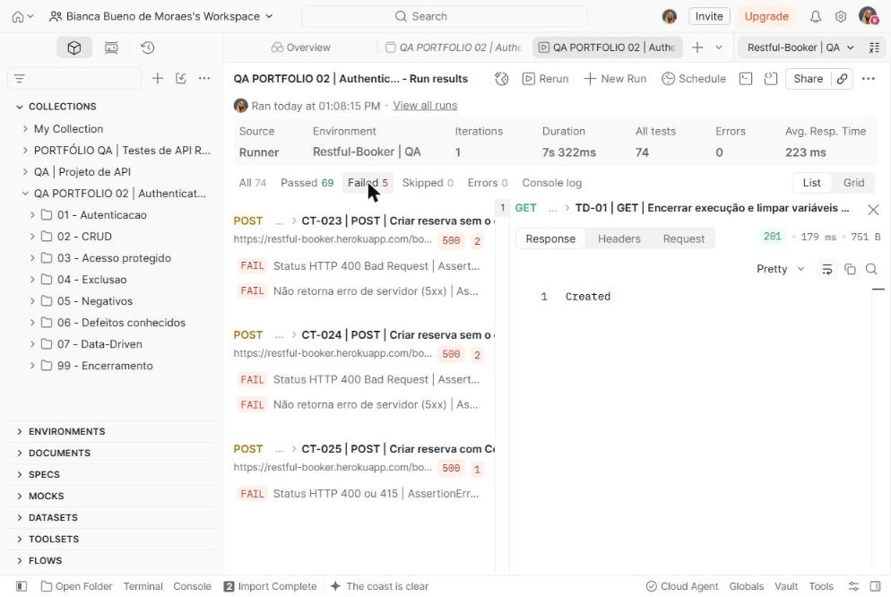
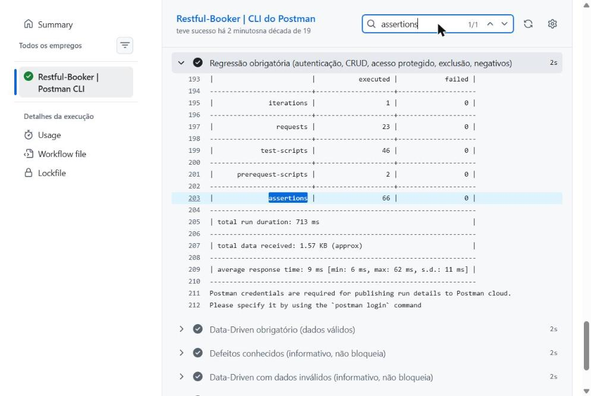
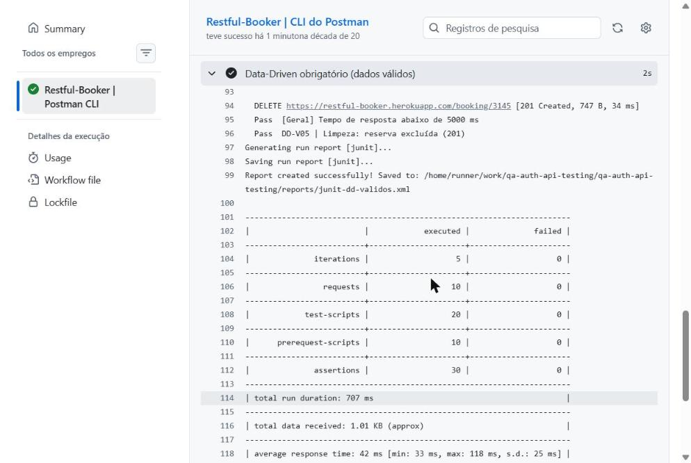
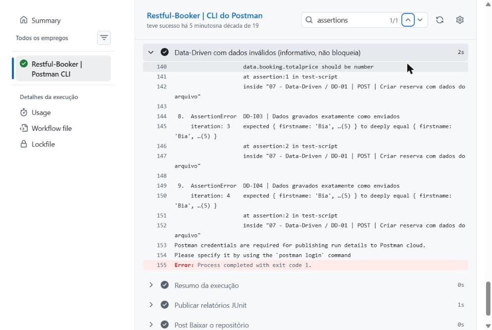

<div align="center">

# QA · Authenticated API Testing

**Postman · Postman CLI · GitHub Actions**

Projeto prático de estudos e portfólio profissional · Bianca Bueno de Moraes · QA Júnior em formação

[](https://github.com/bbmoraes/qa-auth-api-testing/actions/workflows/api-tests.yml)


</div>

> Este é um **projeto de estudos**, não uma experiência profissional. Todos os números abaixo vêm de execuções reais feitas em 15/10/2026, no Postman e no GitHub Actions. Os links para os logs de cada execução estão no [relatório de execução](reports/test-execution-report.md).
>
> O selo verde do workflow indica que a **regressão obrigatória** passou. Os testes que encontram defeitos conhecidos rodam em etapas separadas e informativas, e suas falhas aparecem no resumo de cada execução (veja a seção [Automação](#10-automação-com-github-actions)).

**Projeto anterior:** [qa-api-testing-postman](https://github.com/bbmoraes/qa-api-testing-postman), testes de API REST sem autenticação.

## Sumário

1. [Objetivo](#1-objetivo) · 2. [API utilizada](#2-api-utilizada) · 3. [Tecnologias](#3-tecnologias) · 4. [Estrutura](#4-estrutura) · 5. [Autenticação](#5-autenticação) · 6. [CRUD](#6-operações-crud) · 7. [Positivos e negativos](#7-testes-positivos-e-negativos) · 8. [Data-Driven](#8-data-driven-testing) · 9. [JSON Schema](#9-json-schema) · 10. [GitHub Actions](#10-automação-com-github-actions) · 11. [Resultados](#11-resultados-reais) · 12. [Evidências](#12-evidências) · 13. [Executar localmente](#13-como-executar-localmente) · 14. [Executar pelo GitHub](#14-como-executar-pelo-github) · 15. [Limitações e aprendizados](#15-limitações-e-aprendizados)

## 1. Objetivo

Evoluir o meu primeiro projeto de testes de API, acrescentando:

- **autenticação por token** e acesso a recursos protegidos;
- o **ciclo CRUD completo**, usando só dados criados pelo próprio teste;
- **testes orientados por dados** (Data-Driven);
- **validação de contrato** com JSON Schema;
- **execução automática** a cada atualização do repositório.

## 2. API utilizada

[Restful-Booker](https://restful-booker.herokuapp.com) ([documentação](https://restful-booker.herokuapp.com/apidoc/index.html)) é uma API pública de reservas de hotel, criada para o ensino de testes de API.

| Característica | Impacto no projeto |
|---|---|
| Exige token (ou Basic Auth) para PUT, PATCH e DELETE | Permite testar autenticação de verdade |
| Credenciais de demonstração públicas (`admin` / `password123`) | Ficam no ambiente versionado porque **não são segredos**: estão publicadas na documentação |
| Contém bugs de propósito, segundo o próprio site | Os defeitos encontrados são reais, mas didáticos |
| É compartilhada e volta ao estado inicial a cada 10 minutos | Os testes só criam, alteram e excluem registros **próprios**, identificados por um sobrenome único |
| A documentação descreve só as respostas de sucesso | Para os erros, o esperado segue a RFC 9110, e o que não é documentado vira observação, não bug |

## 3. Tecnologias

| Ferramenta | Uso |
|---|---|
| Postman (web) | Criação da collection e execução no Collection Runner |
| JavaScript (`pm.test`, `pm.expect`, Chai) | Verificações em *Post-response* e montagem de dados em *Pre-request* |
| JSON Schema (draft-07) | Validação de contrato com `pm.response.to.have.jsonSchema` |
| Postman CLI | Execução por linha de comando, com arquivos de dados e relatórios JUnit |
| GitHub Actions | Execução automática a cada push e execução manual |

## 4. Estrutura

```
qa-auth-api-testing/
├── .github/workflows/api-tests.yml          # workflow do GitHub Actions
├── collections/qa-auth-api-tests.postman_collection.json
├── environments/restful-booker.postman_environment.json   # sem segredos
├── data/
│   ├── bookings-valid.json                  # 5 cenários válidos
│   └── bookings-invalid.json                # 4 cenários inválidos
├── schemas/                                 # 4 JSON Schemas (cópia legível dos que estão na collection)
├── test-cases/
│   ├── test-cases.csv                       # CT-001 a CT-025
│   └── data-driven-results.csv              # DD-V01 a DD-I04
├── bug-reports/README.md
├── reports/test-execution-report.md
├── evidence/screenshots/                    # 16 capturas do Postman e do GitHub Actions
└── .gitignore
```

A collection tem **28 requisições** em 8 pastas:

| Pasta | Casos |
|---|---|
| 01 - Autenticacao | CT-001 a CT-004 |
| 02 - CRUD | CT-005 a CT-011 |
| 03 - Acesso protegido | CT-012 a CT-016 |
| 04 - Exclusao | CT-017 a CT-019 |
| 05 - Negativos | CT-020 a CT-022 |
| 06 - Defeitos conhecidos | CT-023 a CT-025 |
| 07 - Data-Driven | DD-01 e DD-02 |
| 99 - Encerramento | TD-01 |

## 5. Autenticação

O CT-002 gera o token e o guarda **somente** em uma variável temporária da collection. O valor nunca é impresso e é apagado no TD-01:

```javascript
pm.test("Contrato: resposta segue o JSON Schema de autenticação", function () {
    const schema = JSON.parse(pm.collectionVariables.get("schemaAuth"));
    pm.response.to.have.jsonSchema(schema);
});

pm.test("Token é uma string não vazia", function () {
    pm.expect(corpo.token).to.be.a("string").and.not.be.empty;
});

pm.collectionVariables.set("token", corpo.token); // usado no header Cookie: token={{token}}
```

O token é enviado no header `Cookie` (CT-008, CT-010, CT-017). O CT-011 usa a alternativa documentada, `Authorization: Basic`.

**Credenciais inválidas:** a documentação não define o código de erro, e a API responde `200` com `{"reason":"Bad credentials"}`. Por isso, o teste valida o que importa para a segurança, sem presumir 401:

```javascript
pm.test("Nenhum token é emitido para credenciais inválidas", function () {
    pm.expect(corpo).to.not.have.property("token");
});
```

## 6. Operações CRUD

| Etapa | Caso | O que é verificado |
|---|---|---|
| Create | CT-005 | 200, JSON Schema, reserva devolvida igual à enviada, captura do `bookingid` |
| Read | CT-006, CT-007 | Consulta por ID e por filtro de nome |
| Update | CT-008 (PUT), CT-010 e CT-011 (PATCH) | Novos valores aplicados e campos não enviados preservados |
| Validação | CT-009, CT-016 | Nova consulta confirma a gravação e que a reserva não mudou após os acessos negados |
| Delete | CT-017 | 201 Created (é o que a documentação define) |
| Pós-exclusão | CT-018, CT-019 | 404 na consulta; 4xx ao excluir de novo |

## 7. Testes positivos e negativos

| Tipo | Exemplos | Resultado |
|---|---|---|
| Sem autenticação | CT-012 (PUT), CT-015 (DELETE) | 403, aprovados |
| Token ou Basic Auth inválido | CT-013, CT-014 | 403, aprovados |
| ID inexistente ou não numérico | CT-020, CT-021 | 404, aprovados |
| Formato incorreto | CT-022 (JSON malformado) → 400, aprovado · CT-025 (text/plain) → **500**, reprovado | — |
| Campos obrigatórios ausentes | CT-023, CT-024 | **500**, reprovados (BUG-01) |

## 8. Data-Driven Testing

A mesma requisição (DD-01) roda **uma vez para cada linha** do arquivo de dados. O JSON preserva os tipos (número, booleano e texto), o que um CSV não faria:

```json
{ "caso": "DD-V03", "descricao": "Valor total igual a zero (limite)", "expectedStatus": 200,
  "payload": { "firstname": "Rafa", "lastname": "DD-Zero", "totalprice": 0, "depositpaid": true,
               "bookingdates": { "checkin": "2026-12-20", "checkout": "2026-12-21" }, "additionalneeds": "Nenhuma" } }
```

```javascript
// Pre-request: sem arquivo de dados, a requisição é pulada
if (!pm.iterationData.has("caso")) {
    pm.execution.skipRequest();
} else {
    pm.collectionVariables.set("ddBody", JSON.stringify(pm.iterationData.get("payload")));
}
```

O DD-02 exclui a reserva criada em cada iteração, então nenhum dado de teste fica na API.

| Arquivo | Linhas | Resultado no GitHub Actions |
|---|---|---|
| `bookings-valid.json` | 5 (acentos, valor zero, valor alto, campo opcional ausente) | 30/30 verificações aprovadas |
| `bookings-invalid.json` | 4 (data DD/MM, data impossível, preço em texto, preço decimal) | 15/24 aprovadas → BUG-03, BUG-04, BUG-05 |

## 9. JSON Schema

Os schemas foram escritos a partir da **documentação** (campos, tipos e o formato `AAAA-MM-DD` das datas), e não copiados de uma resposta. Eles validam tipos, campos obrigatórios, o objeto aninhado `bookingdates`, valores booleanos e o padrão das datas:

```json
"bookingdates": {
  "type": "object",
  "required": ["checkin", "checkout"],
  "properties": {
    "checkin":  { "type": "string", "pattern": "^[0-9]{4}-[0-9]{2}-[0-9]{2}$" },
    "checkout": { "type": "string", "pattern": "^[0-9]{4}-[0-9]{2}-[0-9]{2}$" }
  }
}
```

Os schemas não são enfeite: no DD-I02 e no DD-I03, foi a validação de schema que acusou a data inválida e o `totalprice: null` (`data.booking.totalprice should be number`). Os arquivos estão em [`schemas/`](schemas).

## 10. Automação com GitHub Actions

**Por que Postman CLI e não Newman?** A documentação oficial da Postman indica o Postman CLI para projetos atuais: o Newman só aceita o formato v2.1. O Postman CLI roda arquivos locais **sem chave de API**, aceita arquivo de dados (`-d`), seleção de pastas (`-i`) e relatórios JUnit.

O [workflow](.github/workflows/api-tests.yml) roda a cada push que altera collection, ambiente, dados ou o próprio workflow, e também manualmente (`workflow_dispatch`):

| Etapa | Tipo | O que roda |
|---|---|---|
| Regressão obrigatória | **bloqueia** | Pastas 01 a 05 e 99 |
| Data-Driven obrigatório | **bloqueia** | Pasta 07 com `bookings-valid.json` |
| Defeitos conhecidos | informativa (`continue-on-error`) | Pasta 06 |
| Data-Driven inválidos | informativa (`continue-on-error`) | Pasta 07 com `bookings-invalid.json` |

```yaml
- name: Regressão obrigatória (autenticação, CRUD, acesso protegido, exclusão, negativos)
  run: |
    postman collection run "$COLLECTION" -e "$ENVIRONMENT" \
      -i "01 - Autenticacao" -i "02 - CRUD" -i "03 - Acesso protegido" \
      -i "04 - Exclusao" -i "05 - Negativos" -i "99 - Encerramento" \
      -r cli,junit --reporter-junit-export reports/junit-regressao.xml
```

Separar as etapas evita duas armadilhas: um pipeline sempre vermelho, que ninguém mais olha, e testes de defeitos escondidos. Se qualquer verificação obrigatória falhar, o workflow falha. As etapas informativas aparecem no resumo de cada execução, e os relatórios JUnit ficam disponíveis como artefato.

## 11. Resultados reais

| Execução | Resultado |
|---|---|
| Postman Runner, 13:08 e 13:10 (2 execuções) | 74 verificações: **69 aprovadas, 5 reprovadas**, 0 erros, nas duas |
| GitHub Actions [#1](https://github.com/bbmoraes/qa-auth-api-testing/actions/runs/38767277580) (push) | ✅ Regressão 66/66 · DD válidos 30/30 · defeitos 3/8 · DD inválidos 15/24 |
| GitHub Actions [#2](https://github.com/bbmoraes/qa-auth-api-testing/actions/runs/38768438160) (manual) | ✅ Sucesso |
| GitHub Actions [#3](https://github.com/bbmoraes/qa-auth-api-testing/actions/runs/38769035946) (push, correção do aviso de Node 20) | ✅ Sucesso, sem avisos |

**Casos:** 34 executados (25 funcionais + 9 linhas de dados), 27 aprovados e 7 reprovados. A **taxa de aprovação é 27 ÷ 34 = 79,4%**. Os 7 reprovados são defeitos da API, e nenhum é falha de script.

| Defeito | Caso | Severidade |
|---|---|---|
| BUG-01 · campo obrigatório ausente → 500 | CT-023, CT-024 | Média |
| BUG-02 · Content-Type não suportado → 500 | CT-025 | Baixa |
| BUG-03 · datas inválidas aceitas e gravadas corrompidas | DD-I01, DD-I02 | Alta |
| BUG-04 · preço em texto gravado como `null` | DD-I03 | Alta |
| BUG-05 · preço decimal gravado com perda | DD-I04 | Média |

Mais detalhes em [`bug-reports/`](bug-reports/README.md), [`test-cases/`](test-cases) e no [relatório de execução](reports/test-execution-report.md).

## 12. Evidências

| Postman Runner: as 5 falhas | GitHub Actions: tabela da regressão |
|---|---|
|  |  |
| **Data-Driven válidos (5 iterações, 30/0)** | **Data-Driven inválidos (falhas do schema)** |
|  |  |

As 16 capturas estão em [`evidence/screenshots`](evidence/screenshots).

## 13. Como executar localmente

**No Postman:** importe a collection e o ambiente, selecione `Restful-Booker | QA` e rode a collection. Sem arquivo de dados, a pasta 07 é pulada.

> No Postman web gratuito, rodar a collection com arquivo de dados exige um plano pago. Para o Data-Driven, use o Postman CLI.

**Com o Postman CLI** ([instalação oficial](https://learning.postman.com/docs/postman-cli/postman-cli-installation/)):

```bash
# regressão
postman collection run collections/qa-auth-api-tests.postman_collection.json \
  -e environments/restful-booker.postman_environment.json \
  -i "01 - Autenticacao" -i "02 - CRUD" -i "03 - Acesso protegido" \
  -i "04 - Exclusao" -i "05 - Negativos" -i "99 - Encerramento"

# data-driven
postman collection run collections/qa-auth-api-tests.postman_collection.json \
  -e environments/restful-booker.postman_environment.json \
  -i "07 - Data-Driven" -d data/bookings-valid.json
```

## 14. Como executar pelo GitHub

- **Automático:** qualquer push que altere `collections/`, `environments/`, `data/` ou o workflow.
- **Manual:** aba **Actions** → **API Tests (Postman CLI)** → **Run workflow**.
- **Resultado:** abra a execução para ver o resumo, os logs de cada etapa e o artefato `relatorios-junit`.

## 15. Limitações e aprendizados

**Limitações**

- A API é pública, compartilhada e instável por natureza. Uma falha de rede seria uma instabilidade externa, e não um defeito. Nenhuma foi observada nas execuções registradas.
- Os defeitos são, de propósito, parte da API de treino.
- Comportamentos vistos só na exploração (`depositpaid: "sim"` virando `true`, checkout antes do checkin) ainda não têm teste automatizado.

**Aprendizados**

- Quando a documentação não define o erro, defina o requisito antes de testar (aqui, a RFC 9110) e não chame de bug o que não contraria esse requisito.
- O **status certo não garante dado certo**: no DD-I04, a API responde 200 mas grava o valor errado.
- O JSON Schema pega problemas de tipo e formato que uma checagem de status deixa passar.
- No CI, separar o que deve bloquear do que é informativo mantém o pipeline confiável sem esconder defeitos.
- Testar em ambiente compartilhado exige isolamento (dados únicos) e limpeza (excluir o que foi criado).

---

<sub>Nenhum dado pessoal real, token ou segredo é publicado neste repositório. As credenciais do ambiente são as públicas de demonstração da própria API.</sub>
